# Explainable AI and Robustness Analysis for Network Intrusion Detection


**Author:** Yemisi Akindoyin  

**Year:** 2026  

**Research Areas:** Machine Learning, Cybersecurity, Explainable AI, Trustworthy AI


## 1. Project Overview


This research project investigates the performance, interpretability, and robustness of machine learning models for multiclass network intrusion detection using the CICIDS2017 dataset.


Although machine learning models can achieve high classification accuracy, their reliability under changing network conditions and the transparency of their predictions remain important cybersecurity concerns.


This project goes beyond conventional performance evaluation by integrating SHAP-based explainability, misclassification analysis, and controlled robustness experiments to investigate how an intrusion detection model makes decisions and responds to input perturbations.


## 2. Research Objectives


- Develop and compare machine learning models for multiclass network intrusion detection.

- Evaluate the selected model using an independent held-out test set.

- Investigate global, class-specific, and local model explanations using SHAP.

- Examine misclassification patterns and influential features.

- Assess model robustness under Gaussian noise and feature masking.

- Identify traffic classes that are particularly vulnerable to input perturbations.

- Document experimental configurations and results to support reproducibility.


## 3. Research Questions


1\. Which machine learning model provides the strongest multiclass intrusion detection performance based on macro F1-score?

2\. Which network traffic features contribute most strongly to model predictions?

3\. How do feature contributions differ across traffic classes and individual predictions?

4\. How does model performance change under Gaussian noise and feature masking?

5\. Which traffic classes demonstrate the greatest vulnerability under the investigated perturbation conditions?

6\. Does high baseline classification accuracy necessarily indicate reliable performance under input perturbations?


## 4. Dataset


The project uses the CICIDS2017 dataset developed by the Canadian Institute for Cybersecurity.


Dataset source:

https://www.unb.ca/cic/datasets/ids-2017.html


### Processed Dataset Summary


| Parameter | Value |

|---|---:|

| Total records | 2,520,798 |

| Training partition | 2,016,638 |

| Independent testing records | 504,160 |

| Input features | 69 |

| Traffic classes | 15 |

| Training/testing split | 80:20 |

| Validation proportion | 20% |

| Random seed | 42 |

| Scaled data type | float32 |


The preprocessing workflow includes data quality assessment, invalid value treatment, feature preparation, label encoding, feature scaling, class representation analysis, and class weight verification.


## 5. Experimental Methodology


The research workflow consists of six stages:


1\. Dataset exploration and class distribution analysis.

2\. Data preprocessing and model preparation.

3\. Machine learning model development and comparison.

4\. Independent model evaluation.

5\. Explainable AI and misclassification analysis.

6\. Robustness and reliability analysis.


### Model Selection


Macro F1-score was used as the primary model selection metric because overall accuracy alone can obscure poor performance on underrepresented traffic classes.


The recorded experimental configuration indicates that the independent test set was not used for model selection.


## 6. Machine Learning Model Comparison


Five classification approaches were evaluated.


| Model | Accuracy | Balanced Accuracy | Macro F1 |

|---|---:|---:|---:|

| LightGBM | 99.86% | 90.25% | 88.61% |

| XGBoost | 99.79% | 90.24% | 83.63% |

| Random Forest | 99.34% | 86.30% | 80.03% |

| Logistic Regression | 87.99% | 89.14% | 51.27% |

| Dummy Classifier | 83.11% | 6.67% | 6.05% |


LightGBM achieved the highest validation macro F1-score and was selected for subsequent independent evaluation, explainability, and robustness analysis.


Logistic Regression did not converge under the recorded experimental configuration. Its results should therefore be interpreted with caution.


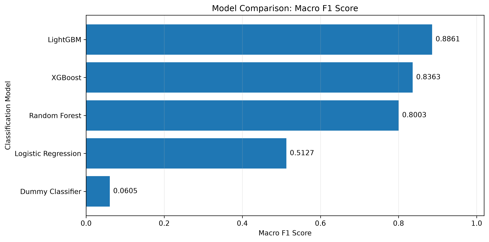


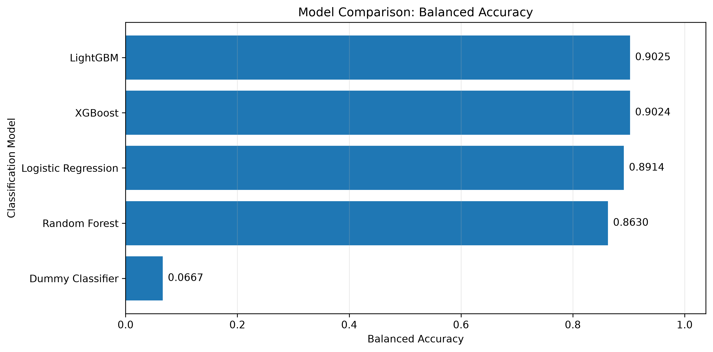


## 7. Independent Model Evaluation


The selected LightGBM model was evaluated on 504,160 held-out test records.


| Evaluation Metric | Result |

|---|---:|

| Accuracy | 99.87% |

| Balanced accuracy | 93.40% |

| Macro precision | 89.45% |

| Macro recall | 93.40% |

| Macro F1-score | 91.08% |

| Weighted F1-score | 99.87% |

| Matthews correlation coefficient | 0.9956 |

| Cohen's kappa | 0.9956 |

| Correct predictions | 503,492 |

| Incorrect predictions | 668 |

| Prediction time | 16.73 seconds |


The difference between overall accuracy and macro F1-score highlights the importance of evaluating performance across individual traffic classes rather than relying exclusively on aggregate accuracy.


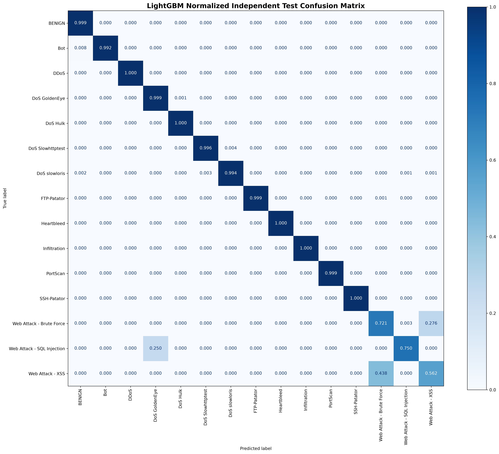


## 8. Explainable AI Analysis


SHAP (SHapley Additive exPlanations) was used to investigate the contribution of network traffic features to model predictions.


The explainability analysis includes:


- Global feature importance.

- Class-specific feature importance.

- Local prediction explanations.

- Misclassification feature analysis.


### Global Feature Importance


| Rank | Feature | Relative SHAP Importance |

|---:|---|---:|

| 1 | Destination Port | 12.91% |

| 2 | Init_Win_bytes_backward | 10.06% |

| 3 | Init_Win_bytes_forward | 7.42% |

| 4 | min_seg_size_forward | 6.70% |

| 5 | Fwd IAT Min | 3.88% |

| 6 | Bwd Packets/s | 3.76% |

| 7 | Flow Duration | 3.33% |

| 8 | Fwd IAT Total | 3.30% |

| 9 | Fwd IAT Std | 2.68% |

| 10 | Flow IAT Min | 2.57% |


The three highest-ranked features account for approximately 30.39% of the reported global SHAP importance.


These findings indicate substantial model reliance on destination port information, TCP window characteristics, and network traffic timing patterns.


SHAP values describe model feature contributions and should not be interpreted as evidence of causal relationships.


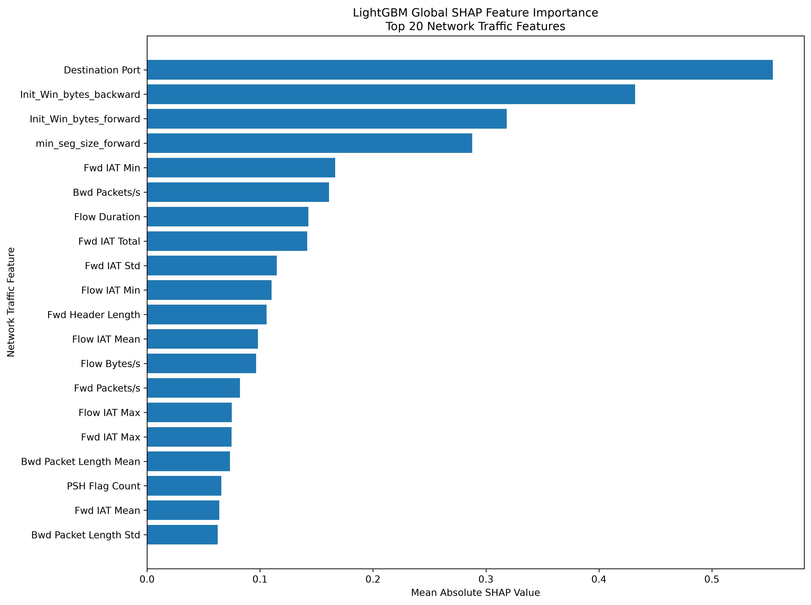


### Class-Specific Explainability


Class-specific SHAP analysis investigates how feature importance varies across different network traffic categories.


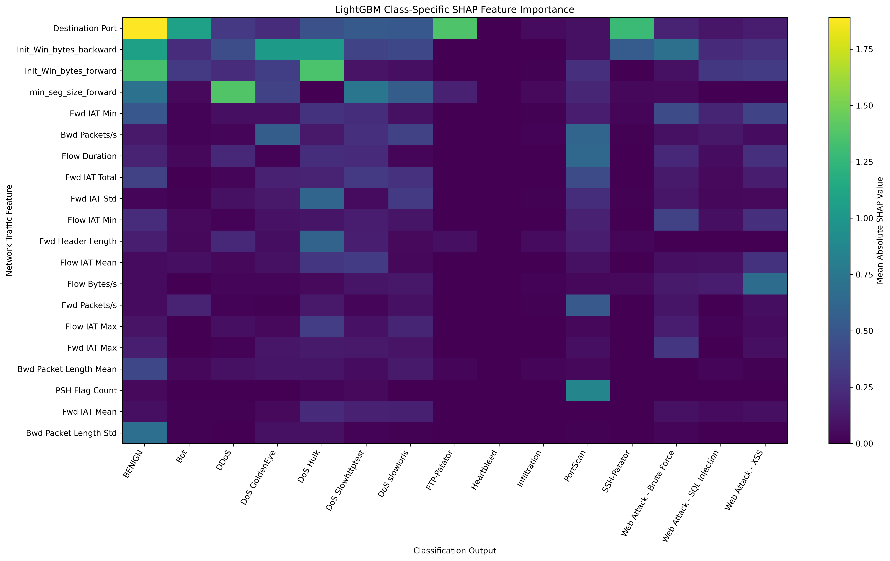


### Local Explainability


Individual prediction explanations provide insight into the features influencing specific classification decisions.


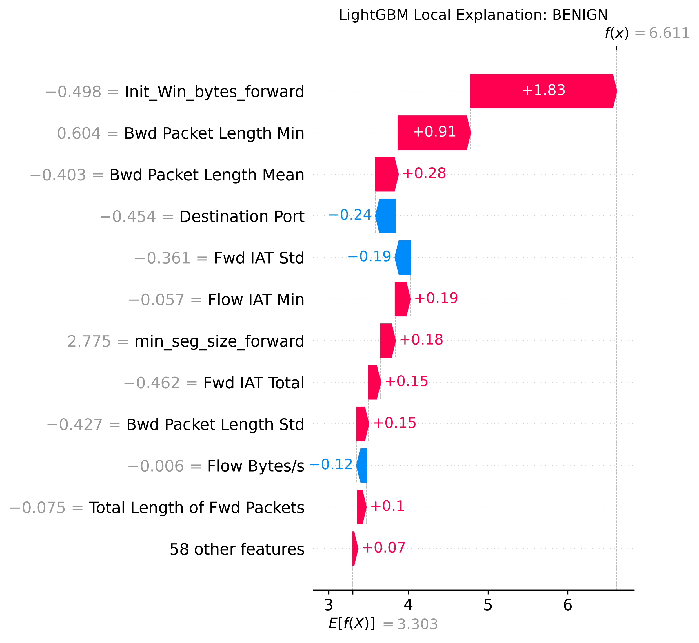


### Misclassification Analysis


Misclassified observations were examined to investigate prediction errors and the features associated with incorrect classifications.


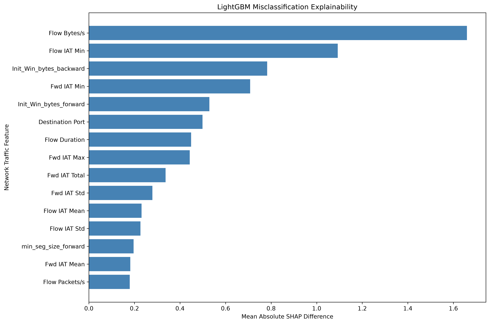


## 9. Robustness and Reliability Analysis


High baseline classification performance does not necessarily guarantee reliable behaviour under changing input conditions.


Two controlled perturbation approaches were investigated:


### Gaussian Noise


Gaussian noise was introduced to investigate model sensitivity to numerical input perturbations.


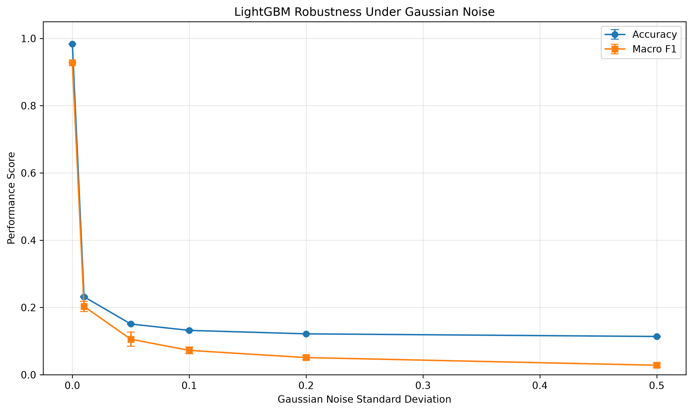


### Feature Masking


Feature masking was used to investigate model sensitivity to the removal or suppression of input information.


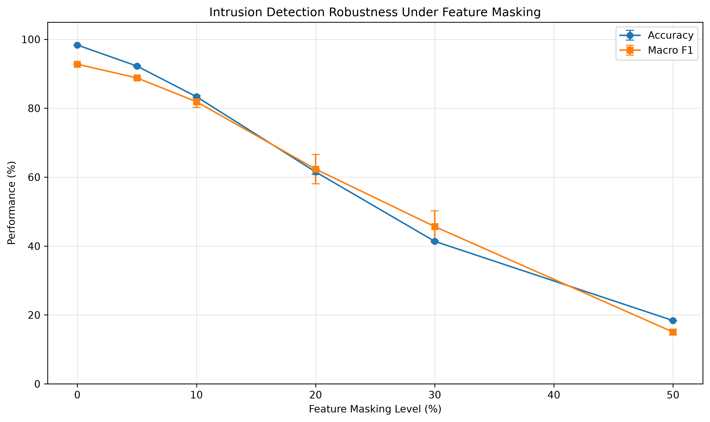


### Class-Level Vulnerability Findings


| Perturbation | Metric | Most Vulnerable Class | Mean Drop (Percentage Points) |

|---|---|---|---:|

| Gaussian Noise | F1-score | DDoS | 99.76 |

| Gaussian Noise | Recall | DDoS | 99.88 |

| Feature Masking | F1-score | BENIGN | 55.19 |

| Feature Masking | Recall | DDoS | 55.41 |


These results represent mean performance reductions under the experimental perturbation conditions.


The findings demonstrate substantial variation in class-level sensitivity and reveal weaknesses that are not apparent from baseline accuracy alone.


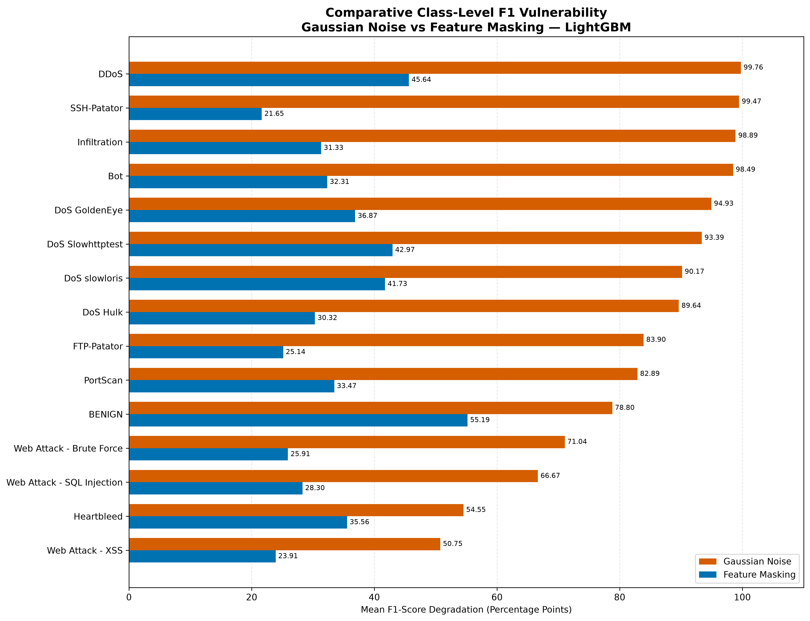


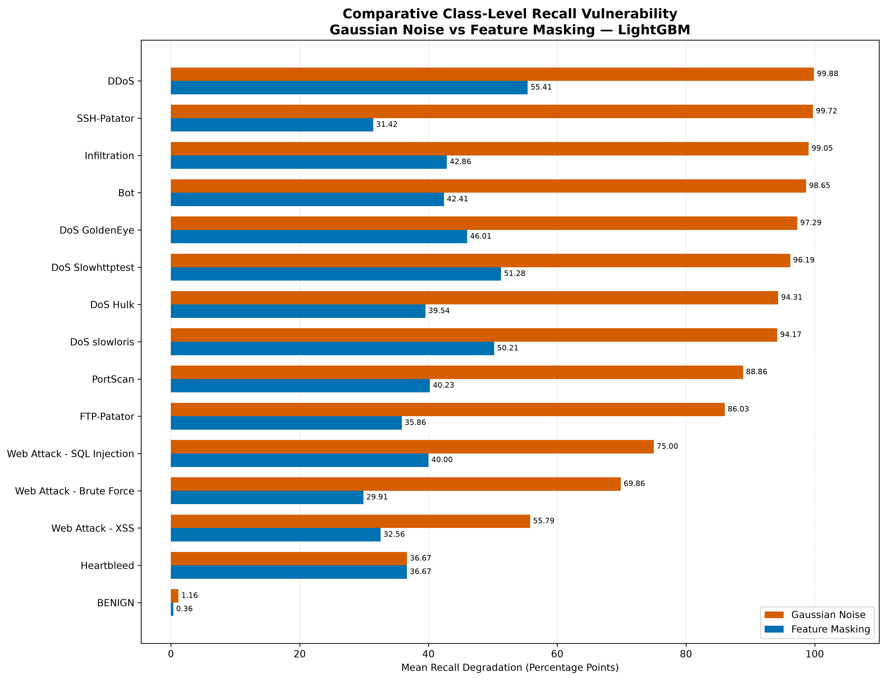


### Experimental Verification


The final robustness verification checks include:


- Completeness of result dimensions.

- Finite numerical values.

- Valid metric ranges.

- Completeness of vulnerability rankings.

- Result file existence and integrity.

- Figure existence and resolution verification.


The recorded final robustness verification checks passed.


These checks establish output consistency and artifact integrity but do not independently establish external validity.


## 10. Key Research Findings


1\. LightGBM achieved the highest validation macro F1-score among the evaluated models.

2\. The selected model achieved 99.87% accuracy and 91.08% macro F1-score on the held-out test set.

3\. Destination Port was the most influential feature in the reported global SHAP analysis.

4\. Class-level robustness varied considerably under Gaussian noise and feature masking.

5\. DDoS demonstrated substantial sensitivity under the investigated perturbation conditions.

6\. High aggregate classification accuracy did not guarantee robustness across all traffic classes.


## 11. Research Limitations


- The experiments are based on a single benchmark dataset.

- Held-out evaluation within CICIDS2017 does not establish cross-dataset or real-world generalization.

- Reliance on destination port information may introduce dataset-specific dependencies.

- Gaussian noise and feature masking are controlled stress tests and do not necessarily represent realistic network traffic modifications.

- SHAP explanations describe model behaviour rather than causal relationships.

- Class imbalance remains an important consideration when interpreting aggregate performance.

- Logistic Regression did not converge under the recorded configuration.

- Real-time deployment performance has not been established.


## 12. Repository Structure


```text

XAI-Intrusion-Detection/

|

|-- 01_Dataset_Exploration.ipynb

|-- 02_Data_Preprocessing_and_Model_Preparation.ipynb

|-- 03_Machine_Learning_Model_Development.ipynb

|-- 04_Independent_Model_Evaluation.ipynb

|-- 05_Explainable_AI_Analysis.ipynb

|-- 06_Robustness_and_Reliability_Analysis.ipynb

|

|-- config/

|-- environment/

|-- figures/

|-- results/

|   |-- robustness/

|

|-- requirements.txt

|-- .gitignore

|-- README.md

```


## 13. Technologies and Tools


- Python

- Jupyter Notebook

- NumPy

- Pandas

- Scikit-learn

- LightGBM

- XGBoost

- SHAP

- Matplotlib

- Git and GitHub


## 14. Reproducibility


### Install Dependencies


```bash

pip install -r requirements.txt

```


### Launch Jupyter Notebook


```bash

jupyter notebook

```


### Execution Order


Execute the six notebooks sequentially, beginning with dataset exploration and ending with robustness and reliability analysis.


Download the CICIDS2017 dataset from its original source and configure the dataset paths according to the notebooks.


Large generated arrays and other excluded artifacts must be regenerated locally where required.


Experimental configurations, evaluation summaries, visualizations, and verification outputs are included in the repository.


The recorded experimental environment used:


- 8 logical CPU cores.

- Approximately 31.69 GB RAM.

- 4 parallel jobs.

- Random seed 42.


Execution time may vary depending on hardware and software configurations.


## 15. Future Research Directions


Potential extensions of this work include:


- Cross-dataset evaluation using additional intrusion detection benchmarks.

- Temporal and network-environment-based validation.

- Investigation of dataset-specific feature dependencies.

- Evaluation under more realistic network traffic perturbations.

- Robust feature selection and robustness-aware model development.

- Investigation of explanation stability under distribution shifts.

- Integration of uncertainty estimation into intrusion detection decisions.

- Development of more trustworthy and interpretable cybersecurity decision-support systems.


## 16. Research Significance


This project explores the intersection of cybersecurity, machine learning, explainability, and model reliability.


Rather than treating classification accuracy as the sole indicator of success, it investigates how models make predictions, where they fail, and how their performance changes under controlled input perturbations.


The work provides a foundation for further research into trustworthy machine learning for cybersecurity applications.


## 17. Author


**Yemisi Akindoyin**


Computer Science graduate with a background in cybersecurity and research interests in:


- Explainable Artificial Intelligence

- Trustworthy Machine Learning

- Network Intrusion Detection

- Cyber Threat Intelligence

- Model Robustness and Reliability


GitHub: https://github.com/akindoyinyemisi


## 18. References and Acknowledgements


- Canadian Institute for Cybersecurity. CICIDS2017 Intrusion Detection Evaluation Dataset.

- Lundberg, S. M., and Lee, S. I. (2017). A Unified Approach to Interpreting Model Predictions.

- Ke, G., et al. (2017). LightGBM: A Highly Efficient Gradient Boosting Decision Tree.

- Chen, T., and Guestrin, C. (2016). XGBoost: A Scalable Tree Boosting System.


This repository documents a research-oriented machine learning project and is not presented as a peer-reviewed publication or a production-ready intrusion detection system.

